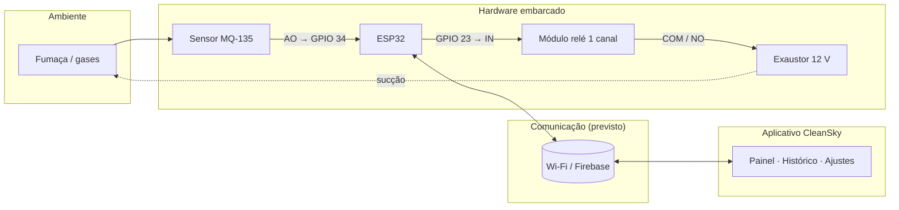
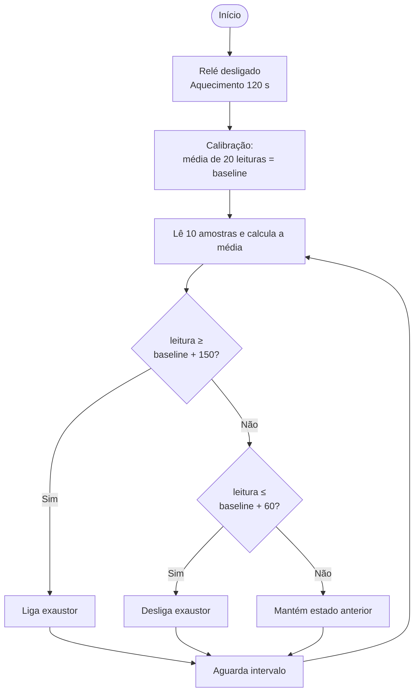

<div align="center">

# ☁️ CleanSky

### Sistema de monitoramento da qualidade do ar e exaustão automática de fumaça
#### Base de um drone purificador de ar para resposta a emergências

**Projeto Integrador · Análise e Desenvolvimento de Sistemas (ADS)**
**FATEC Zona Leste — Centro Paula Souza**


</div>

---

## 📑 Sumário

1. [Visão geral](#-visão-geral)
2. [Contexto e motivação](#-contexto-e-motivação)
3. [Objetivos](#-objetivos)
4. [Arquitetura do sistema](#-arquitetura-do-sistema)
5. [Hardware](#-hardware)
6. [Firmware (ESP32)](#-firmware-esp32)
7. [Aplicativo móvel](#-aplicativo-móvel)
8. [Estrutura do repositório](#-estrutura-do-repositório)
9. [Como executar o aplicativo](#-como-executar-o-aplicativo)
10. [Como testar](#-como-testar)
11. [Estado atual e roadmap](#-estado-atual-e-roadmap)
12. [Limitações conhecidas](#-limitações-conhecidas)
13. [Decisões técnicas](#-decisões-técnicas)
14. [Solução de problemas](#-solução-de-problemas)
15. [Equipe](#-equipe)
16. [Referências](#-referências)
17. [Licença](#-licença)

---

## 🔭 Visão geral

O **CleanSky** é uma prova de conceito (PoC) de um sistema móvel de purificação de ar, pensado para ser embarcado em um **VANT (drone)** capaz de aspirar fumaça tóxica e monitorar a qualidade do ar em zonas de risco, como incêndios, queimadas e acidentes industriais.

Este repositório reúne o **aplicativo móvel** do projeto, desenvolvido em **React Native com TypeScript**, que permite ao operador:

- parear o dispositivo CleanSky pelo número de série (ou QR Code);
- acompanhar em tempo real o nível de fumaça no ambiente;
- receber alertas quando a fumaça se torna densa;
- consultar o histórico de leituras por período;
- ajustar os limiares de alerta e o comportamento automático do purificador;
- ligar e desligar o purificador remotamente.

O sistema completo é formado por três partes que se complementam:

| Camada | Tecnologia | Responsabilidade |
|---|---|---|
| **Sensoriamento e atuação** | ESP32 + MQ-135 + relé + exaustor 12 V | Ler o ar, calibrar, decidir e acionar o exaustor de forma autônoma |
| **Comunicação / nuvem** | Wi-Fi do ESP32, Firebase (previsto) | Transportar telemetria e comandos |
| **Aplicativo móvel** | React Native + TypeScript + Expo | Supervisão remota, alertas, histórico e ajustes |

> **Princípio de projeto:** o controle do exaustor é feito **localmente pelo firmware**. O aplicativo é uma camada de **supervisão remota**. Se o celular ou a rede falharem, o sistema continua funcionando sozinho.

---

## 🌫️ Contexto e motivação

A fumaça gerada em incêndios e queimadas é uma das principais causas de fatalidades e reduz a visibilidade das equipes de emergência. As soluções tradicionais de exaustão são terrestres, estáticas e lentas, e exigem a exposição de pessoas à área de risco.

Um VANT permite uma **resposta rápida e não tripulada**, capaz de entrar em ambientes críticos para fazer a sucção diretamente na fonte, criando corredores de ar respirável para resgates. Além disso, soluções isoladas de sensores ou de curto alcance (como BLE) exigem proximidade constante, o que o monitoramento remoto via Wi-Fi e nuvem busca superar.

O projeto se alinha aos **Objetivos de Desenvolvimento Sustentável (ODS) da ONU** (Saúde, Inovação, Cidades Sustentáveis e Ação Climática) e às diretrizes da **Organização Mundial da Saúde** para a mitigação de material particulado fino (PM2,5 e PM10).

---

## 🎯 Objetivos

### Objetivo geral

Desenvolver e avaliar uma **prova de conceito** de um sistema móvel de purificação de ar embarcável em VANT, validando em bancada a viabilidade técnica de um módulo integrado de **sucção, filtragem e monitoramento IoT**.

### Objetivos específicos

- [x] Montar em bancada um módulo de sucção e filtragem acoplável ao chassi de um VANT.
- [x] Incorporar sensor de qualidade do ar ao sistema (MQ-135 na bancada atual).
- [x] Implementar a lógica de controle autônomo no ESP32 (aquecimento, calibração, filtragem e histerese).
- [x] Desenvolver o aplicativo móvel de supervisão (este repositório).
- [ ] Integrar o aplicativo ao ESP32 por telemetria real.
- [ ] Executar ensaios quantitativos de sucção, peso e consumo de bateria.
- [ ] Validar aerodinamicamente em voo real *(trabalho futuro)*.

---

## 🧩 Arquitetura do sistema



**Fluxo de decisão:** a decisão de ligar ou desligar o exaustor acontece **dentro do ESP32**. O aplicativo recebe a telemetria (nível do ar e estado do exaustor) e pode enviar comandos e configurações.

---

## 🔌 Hardware

### Lista de componentes

| Componente | Conexão | Função |
|---|---|---|
| **ESP32** | — | Processamento, leitura analógica, acionamento do atuador e conectividade Wi-Fi/Bluetooth |
| **Sensor MQ-135** | `AO → GPIO 34` | Detecção de CO₂, fumaça, amônia e compostos orgânicos voláteis |
| **Módulo relé 1 canal (ativo em LOW)** | `IN → GPIO 23` | Isolamento e chaveamento da carga de potência |
| **Exaustor / motor DC 12 V** | Bornes `COM` e `NO` do relé | Extração da fumaça do ambiente |
| **Fonte externa / bateria LiPo 7,4 V** | GND comum com o ESP32 | Energia estável para o motor e componentes auxiliares |
| **Drone Eachine E511S** | — | Chassi-base para a integração aérea futura |

### Pinagem

| Pino do ESP32 | Modo | Ligado a |
|---|---|---|
| `GPIO 34` | Entrada analógica (ADC1, atenuação 11 dB) | Saída `AO` do MQ-135 |
| `GPIO 23` | Saída digital (dreno aberto) | Pino `IN` do módulo de relé |
| `GND` | Terra comum | Terra da fonte externa, sensor e relé |

### Pontos de atenção elétricos

- **GPIO 34 pertence ao ADC1**, que continua utilizável com o Wi-Fi ligado, requisito para a telemetria futura. O ADC2 não tem essa propriedade.
- **Relé ativo em nível baixo:** `HIGH` mantém o relé em repouso (exaustor desligado) e `LOW` o aciona. O motor fica no contato **normalmente aberto (NO)**, portanto permanece fisicamente desligado quando o relé está em repouso.
- **Módulos de relé de 5 V** acionados diretamente por 3,3 V podem ficar parcialmente acionados em nível alto. Nos testes, isso foi contornado configurando o pino como **`OUTPUT_OPEN_DRAIN`**.
- **Saída `AO` do MQ-135 pode ultrapassar 3,3 V** quando o módulo é alimentado com 5 V. Recomenda-se um **divisor resistivo** para proteger a entrada do ADC.
- **Aquecimento:** o elemento sensível do MQ-135 precisa de tempo para atingir a temperatura de operação. Na primeira utilização do sensor, tempos maiores podem ser necessários.

---

## 🧠 Firmware (ESP32)

O firmware é escrito em **C++ na Arduino IDE** e executa quatro etapas.

| Etapa | O que faz |
|---|---|
| **1. Aquecimento** | Ao iniciar, aguarda **120 s** com o relé desligado para o sensor estabilizar |
| **2. Calibração** | Calcula a média de **20 leituras em ar limpo** e define a **linha de base** (*baseline*) |
| **3. Filtragem** | Cada leitura é a média de **10 amostras** espaçadas de 5 ms, atenuando o ruído do ADC |
| **4. Acionamento** | A cada ciclo (~550 ms), compara a leitura com os limiares calculados a partir da linha de base |

### Controle liga-desliga com histerese

Se um único valor definisse ligar e desligar, pequenas flutuações em torno dele fariam o relé comutar rapidamente (*chattering*), desgastando relé e motor. A **histerese** usa dois limiares:

```
leitura
   ▲
   │                     ┌──────── LIGA quando leitura ≥ baseline + 150
   │               ╱╲   ╱
   │          ╱╲  ╱  ╲ ╱
   │         ╱  ╲╱    ╳        ← zona morta: mantém o estado anterior
   │ ───────╱─────────╲───── DESLIGA quando leitura ≤ baseline + 60
   │  ~~~~~~                 ~~~~~~~
   └─────────────────────────────────▶ tempo
```

Como os limiares são **relativos à linha de base**, e a calibração ocorre a cada inicialização, o sistema se adapta ao ambiente e ao sensor sem ajuste manual.

### Parâmetros de configuração

| Parâmetro | Valor | Unidade | Descrição |
|---|---|---|---|
| `TEMPO_AQUECIMENTO` | 120000 | ms | Aquecimento do sensor |
| Leituras de calibração | 20 | amostras | Média que define a linha de base |
| Amostras por leitura | 10 | amostras | Média contra ruído (5 ms entre amostras) |
| `DELTA_LIGA` | 150 | unid. ADC | Margem acima da linha de base para ligar |
| `DELTA_DESLIGA` | 60 | unid. ADC | Margem acima da linha de base para desligar |
| `INTERVALO_MS` | 500 | ms | Pausa entre leituras no laço principal |

### Classificação do ar

| Estado | Condição da leitura | Ação do exaustor |
|---|---|---|
| 🟢 **Excelente** (ar limpo) | `leitura < baseline + 60` | Desligado, ou desliga ao retornar a este patamar |
| 🟡 **Moderado** (monitorando) | `baseline + 60 ≤ leitura < baseline + 150` | Mantém o estado anterior (zona de histerese) |
| 🔴 **Crítico** (fumaça) | `leitura ≥ baseline + 150` | Liga automaticamente |

### Fluxo de operação



### Pseudocódigo ilustrativo

> Resumo da lógica descrita acima, **não** é o código final do firmware.

```cpp
void setup() {
  analogSetPinAttenuation(34, ADC_11db);
  pinMode(23, OUTPUT_OPEN_DRAIN);
  digitalWrite(23, HIGH);          // relé em repouso (ativo em LOW)

  delay(TEMPO_AQUECIMENTO);        // aquecimento do MQ-135
  baseline = mediaDeLeituras(20);  // calibração em ar limpo
}

void loop() {
  int leitura = mediaDeAmostras(10, 5 /* ms */);

  if (leitura >= baseline + DELTA_LIGA)        ligarExaustor();
  else if (leitura <= baseline + DELTA_DESLIGA) desligarExaustor();
  // entre os dois limiares: mantém o estado anterior (histerese)

  delay(INTERVALO_MS);
}
```

---

## 📱 Aplicativo móvel

### Stack

| Tecnologia | Uso |
|---|---|
| **React Native** | Base do app multiplataforma |
| **TypeScript** | Tipagem estática em todo o código |
| **Expo + Expo Router** | Ferramentas de build e navegação por pastas (rotas por arquivo) |
| **React Native Paper** | Componentes de interface (Material Design) |
| **@expo/vector-icons** | Ícones (Material Community Icons) |
| **react-native-svg** | Gráfico de linha das leituras |
| **@react-native-async-storage/async-storage** | Persistência local de ajustes e do número de série |
| **@react-native-community/slider** | Controles deslizantes dos limiares |
| **expo-camera** *(previsto)* | Leitura de QR Code no pareamento |

### Telas

| Tela | Rota | Descrição |
|---|---|---|
| **Conectar dispositivo** | `/` | Digitar o número de série (ex.: `CS-ESP32-9042`) ou escanear o QR Code para parear o CleanSky |
| **Painel** | `/(tabs)/painel` | Card de qualidade do ar com cor por nível, valor em ppm, alerta de fumaça densa, gráfico das últimas leituras e lista recente |
| **Histórico** | `/(tabs)/historico` | Lista de leituras com filtro de período (1 h, 6 h, 24 h) |
| **Ajustes** | `/(tabs)/ajustes` | Limiares de fumaça moderada e densa, notificações push e limpeza automática |

O botão flutuante **Ligar / Desligar purificador** aparece no Painel e no Histórico.

### Níveis de qualidade do ar

| Nível | Cor | Texto do app |
|---|---|---|
| `clean` | 🟢 Verde | Ar limpo |
| `moderate` | 🟡 Amarelo | Fumaça moderada |
| `dense` | 🔴 Vermelho | Fumaça densa |

A classificação compara a leitura com os dois limiares configuráveis nos Ajustes (padrões: **596** e **910**):

```ts
export function classify(value: number, limits: { moderateStart: number; denseAlert: number }): AirLevel {
  if (value >= limits.denseAlert) return 'dense';
  if (value >= limits.moderateStart) return 'moderate';
  return 'clean';
}
```

### Gerenciamento de estado

Todo o estado compartilhado vive em um **contexto React** (`CleanSkyContext`), consumido pelas telas por meio do hook `useCleanSky()`.

| Campo | Tipo | Descrição |
|---|---|---|
| `readings` | `Reading[]` | Leituras recebidas (mantém as últimas 300) |
| `current` | `Reading \| undefined` | Leitura mais recente |
| `settings` | `Settings` | Limiares e preferências (persistidos no aparelho) |
| `updateSettings(patch)` | função | Atualiza e salva os ajustes |
| `purifierOn` | `boolean` | Estado do purificador |
| `togglePurifier()` | função | Liga ou desliga o purificador |
| `alertVisible` | `boolean` | Controla o aviso de fumaça densa |
| `dismissAlert()` | função | Fecha o aviso manualmente |

**Regras de negócio implementadas:**

- Ao **entrar** no nível `dense`, o alerta é exibido e, se a **limpeza automática** estiver ativa, o purificador é ligado.
- Ao **sair** do nível `dense`, o alerta some sozinho (também pode ser fechado em *Entendi*).
- Os limiares nunca se cruzam: "fumaça moderada" fica sempre pelo menos **10 unidades** abaixo de "fumaça densa".

### Modelos de dados

```ts
export type AirLevel = 'clean' | 'moderate' | 'dense';

export interface Reading {
  id: string;
  level: AirLevel;
  ppm: number;
  timestamp: number; // epoch em ms
}

export interface Settings {
  moderateStart: number;
  denseAlert: number;
  pushNotifications: boolean;
  autoCleaning: boolean;
}
```

### Camada de dados: simulação hoje, hardware amanhã

Enquanto a comunicação com o ESP32 não está integrada, o contexto **simula leituras** a cada 3 segundos (com ruído e picos aleatórios de fumaça), e gera um histórico inicial de 20 minutos para o gráfico não nascer vazio. Esse trecho está isolado e marcado com o comentário `SIMULAÇÃO` em `src/context/CleanSkyContext.tsx`.

Para integrar com o hardware, basta **substituir esse bloco** pela leitura real (Firebase, HTTP ou outro canal), mantendo `setReadings`, a lógica de alerta e as telas intactas.

---

## 🗂️ Estrutura do repositório

```
cleansky/
├── src/
│   ├── app/                       # Rotas (Expo Router)
│   │   ├── _layout.tsx            # Tema (Paper) + CleanSkyProvider + Stack
│   │   ├── index.tsx              # Conectar dispositivo
│   │   └── (tabs)/
│   │       ├── _layout.tsx        # Barra de abas
│   │       ├── painel.tsx
│   │       ├── historico.tsx
│   │       └── ajustes.tsx
│   ├── components/
│   │   ├── ReadingChart.tsx       # Gráfico de linha (SVG)
│   │   ├── ReadingList.tsx        # Lista de leituras
│   │   └── PurifierButton.tsx     # Botão flutuante do purificador
│   ├── context/
│   │   └── CleanSkyContext.tsx    # Estado global + simulação de dados
│   ├── theme/
│   │   └── colors.ts              # Paleta do tema escuro
│   ├── types/
│   │   └── index.ts               # AirLevel, Reading, Settings
│   └── utils/
│       └── airQuality.ts          # classify(), rótulos e cores por nível
├── assets/
├── app.json
├── package.json
├── tsconfig.json
└── README.md
```

> Tudo dentro de `src/app/` vira rota. Por isso `components/`, `context/`, `theme/`, `types/` e `utils/` ficam **fora** dessa pasta, direto em `src/`.

O alias `@/` aponta para `src/` (configurado no `tsconfig.json`), permitindo imports como `import { colors } from '@/theme/colors'`.

---

## 🚀 Como executar o aplicativo

### Pré-requisitos

- [Node.js](https://nodejs.org/) (versão LTS)
- [Git](https://git-scm.com/)
- App **Expo Go** no celular (Android ou iOS) *ou* um emulador
- Editor recomendado: **VS Code**, com as extensões *ES7+ React/Redux/React Native snippets* e *ESLint*

### Instalação

```bash
# 1. Clonar o repositório
git clone <url-do-repositorio>
cd cleansky

# 2. Instalar as dependências (dentro da pasta do projeto!)
npm install

# 3. Iniciar o servidor de desenvolvimento
npx expo start
```

Escaneie o **QR Code** exibido no terminal com o Expo Go (Android) ou com a câmera (iOS). O celular e o computador devem estar na **mesma rede Wi-Fi**.

### Criando o projeto do zero (referência)

Caso queira reproduzir a base do projeto:

```bash
npx create-expo-app@latest cleansky
cd cleansky
npm run reset-project

npm install react-native-paper
npx expo install react-native-safe-area-context react-native-svg \
  @react-native-async-storage/async-storage expo-camera \
  @react-native-community/slider @expo/vector-icons
```

### Scripts úteis

| Comando | O que faz |
|---|---|
| `npx expo start` | Inicia o servidor de desenvolvimento |
| `npx expo start -c` | Inicia limpando o cache do Metro |
| `npx expo install --check` | Verifica pacotes fora da versão recomendada |
| `npx tsc --noEmit` | Verifica erros de TypeScript sem gerar arquivos |

---

## 🧪 Como testar

Enquanto os dados são simulados, é possível exercitar todo o fluxo no próprio app:

| O que testar | Como |
|---|---|
| **Pareamento** | Digite qualquer número de série (ex.: `CS-ESP32-9042`) e toque no ✓. O valor é salvo e o app vai para o Painel |
| **Cores por nível** | Observe o card do Painel mudar entre verde, amarelo e vermelho conforme as leituras |
| **Alerta de fumaça densa** | Em *Ajustes*, baixe "Fumaça densa" para ~350. Quando uma leitura ultrapassar, o aviso aparece e, com a limpeza automática ativa, o purificador liga |
| **Alerta some sozinho** | Aguarde o ar voltar abaixo do limite: o aviso vermelho desaparece |
| **Persistência** | Altere os ajustes, feche o app por completo e reabra: os valores permanecem |
| **Limites protegidos** | Tente levar "moderada" acima de "densa": o valor para no máximo permitido |
| **Filtro de período** | No Histórico, alterne entre 1 h, 6 h e 24 h |

---

## 🗺️ Estado atual e roadmap

| Funcionalidade | Status |
|---|:---:|
| Tela de pareamento por número de série | ✅ |
| Painel com card, alerta, gráfico e leituras recentes | ✅ |
| Histórico com filtro de período | ✅ |
| Ajustes com persistência local | ✅ |
| Alerta de fumaça densa (aparece e some automaticamente) | ✅ |
| Limpeza automática (lógica no app) | ✅ |
| Firmware com aquecimento, calibração, filtro e histerese | ✅ |
| Leitura de **QR Code** no pareamento | 🚧 |
| **Notificações push** reais | 🚧 |
| **Integração real** com o ESP32 (Firebase / Wi-Fi) | 🚧 |
| Envio de comandos ao hardware (ligar/desligar) | 🚧 |
| Rótulos do gráfico baseados no tempo real das leituras | 🚧 |
| Ensaios quantitativos (sucção, peso, bateria) | 🔜 |
| Validação aerodinâmica e voo real | 🔜 |
| Mapeamento preditivo da fumaça com IA | 🔜 |
| Comunicação autônoma 4G/5G | 🔜 |

✅ concluído · 🚧 em desenvolvimento / próximo passo · 🔜 trabalho futuro

---

## ⚠️ Limitações conhecidas

**Do hardware e do método**

- O protótipo foi validado **apenas em bancada**; não houve ensaio de voo.
- O **MQ-135 é pouco seletivo**: indica uma variação *relativa* da qualidade do ar, sem converter a leitura em concentração de um gás específico.
- A **calibração automática só é válida se o ar estiver limpo na inicialização**. Se houver fumaça nesse momento, a linha de base fica elevada e o sistema perde sensibilidade.
- Ainda não foram feitos ensaios de tempo de resposta, repetibilidade ou eficiência de remoção de poluentes.
- Existe um *trade-off* entre o **peso extra** do sistema de filtros e exaustão e a **autonomia de bateria** do drone.

**Do aplicativo**

- Os dados exibidos são **simulados** até a integração com o ESP32.
- O app trabalha com **valores absolutos** (padrão 596 e 910), enquanto o firmware decide por limiares **relativos à linha de base** (+150 / +60). A harmonização entre as duas escalas é um ponto em aberto (veja a seção seguinte).
- O estado do purificador no app ainda é local, sem confirmação do hardware.
- O canal de comunicação, a latência da telemetria e a usabilidade da interface ainda não foram avaliados.

### Pontos em aberto de projeto

1. **Escala dos limiares:** definir se o app exibirá o valor bruto do ADC, um valor relativo à linha de base ou uma estimativa em ppm, e alinhar os padrões do app com o comportamento do firmware.
2. **Sensor:** o protótipo de bancada usa o **MQ-135** (gases). Alguns materiais iniciais do projeto citam também o **PMS5003** (material particulado); é preciso padronizar qual sensor consta na versão final.
3. **Canal de telemetria:** Firebase, HTTP direto no ESP32 ou MQTT (citado como trabalho futuro).

---

## 🛠️ Decisões técnicas

| Decisão | Motivo |
|---|---|
| **Controle autônomo no firmware** | O sistema segue funcionando mesmo sem celular ou rede |
| **Histerese em vez de limiar único** | Evita *chattering* do relé e desgaste do motor |
| **Calibração a cada inicialização** | Torna o sistema independente das diferenças entre unidades do MQ-135, temperatura, umidade e tempo de uso |
| **Expo + Expo Router** | Início rápido, teste direto no celular com Expo Go e navegação por arquivos |
| **React Native Paper** | Componentes prontos e temáveis, com visual consistente |
| **Contexto React no lugar de uma lib de estado** | O estado é pequeno e centralizado; menos dependências |
| **Dados simulados isolados em um bloco** | Permite desenvolver e demonstrar o app antes do hardware, com troca simples depois |
| **Sliders sem "correção" durante o arraste** | Validar apenas ao soltar evita travamentos causados por disputa de posição |
| **Botões − / + nos sliders** | Ajuste fino sem depender da precisão do dedo |
| **Interface em português, código em inglês/português técnico** | Público-alvo brasileiro, com identificadores de tipos em inglês |

---

## 🩺 Solução de problemas

| Sintoma | Causa provável | Solução |
|---|---|---|
| Import sublinhado em vermelho (`@expo/vector-icons`, `async-storage`) | Pacote instalado na pasta errada ou TS desatualizado | Rode `npm install` **dentro** da pasta do app, depois `Ctrl + Shift + P` → *TypeScript: Restart TS Server* |
| Dois `node_modules` / dois `package.json` | `npm install` executado fora da pasta do projeto | Apague os arquivos da pasta de fora e abra o VS Code na pasta do app |
| Telas não aparecem / rota não encontrada | Pasta de abas sem parênteses | O nome deve ser `(tabs)`, com parênteses |
| Erro "Route is missing the default export" | Arquivo que não é tela dentro de `src/app/` | Mova `types/`, `utils/` e similares para fora de `app/` |
| `Requiring unknown module "59"` no terminal | Pré-renderização web do Expo Router | Afeta só a versão web. Em `app.json`, use `"web": { "output": "single" }` |
| Aviso `useNativeDriver` na web | Módulo nativo de animação ausente no navegador | Aviso inofensivo na web; não ocorre no celular |
| Slider "engasga" | Valor corrigido a cada movimento do dedo | Use a versão atual de `ajustes.tsx` (valida ao soltar) |
| Comportamento estranho após mexer em dependências | Cache do Metro | `npx expo start -c` |

---

## 👥 Equipe

| Integrante | Curso |
|---|---|
| Henrique de Moraes Rodrigues | ADS — FATEC Zona Leste |
| Miguel Gustavo de Sousa Campos | ADS — FATEC Zona Leste |
| Victor Hugo Navarro Taveira | ADS — FATEC Zona Leste |

**Instituição:** Faculdade de Tecnologia (FATEC) Zona Leste — Centro Paula Souza, São Paulo, SP.

---

## 📚 Referências

- ABNT. **ABNT NBR ISO/IEC 20924**: Internet das coisas (IoT) e gêmeos digitais — Vocabulário.
- ALVEAR, O. et al. **Autonomous Multi-Rotor Aerial Platform for Air Pollution Monitoring**. *Sensors* (MDPI), v. 22, n. 3, 2022. <https://www.mdpi.com/1424-8220/22/3/860>
- ATZORI, L.; IERA, A.; MORABITO, G. **The Internet of Things: a survey**. *Computer Networks*, v. 54, n. 15, p. 2787-2805, 2010.
- ESPRESSIF SYSTEMS. **ESP32 Technical Reference Manual**. <https://documentation.espressif.com/esp32_technical_reference_manual_en.pdf>
- HANWEI ELECTRONICS. **MQ135 Semiconductor Sensor for Air Quality: technical data**.
- OASIS. **MQTT Version 3.1.1**. OASIS Standard, 2014.
- OGATA, K. **Engenharia de controle moderno**. 5. ed. São Paulo: Pearson, 2010.
- PLANTOWER. **PMS5003 Digital universal particle concentration sensor data manual**.
- WORLD HEALTH ORGANIZATION. **WHO global air quality guidelines: particulate matter (PM2.5 and PM10), ozone, nitrogen dioxide, sulfur dioxide and carbon monoxide**. Geneva, 2021. <https://www.who.int/publications/i/item/9789240034228>

---

## 📄 Licença

Projeto acadêmico desenvolvido para fins educacionais no âmbito do Projeto Integrador da FATEC Zona Leste.
Defina aqui a licença do repositório (por exemplo, MIT) antes de publicar.

<div align="center">

**CleanSky** · purificando o ar a partir do céu ☁️

</div>